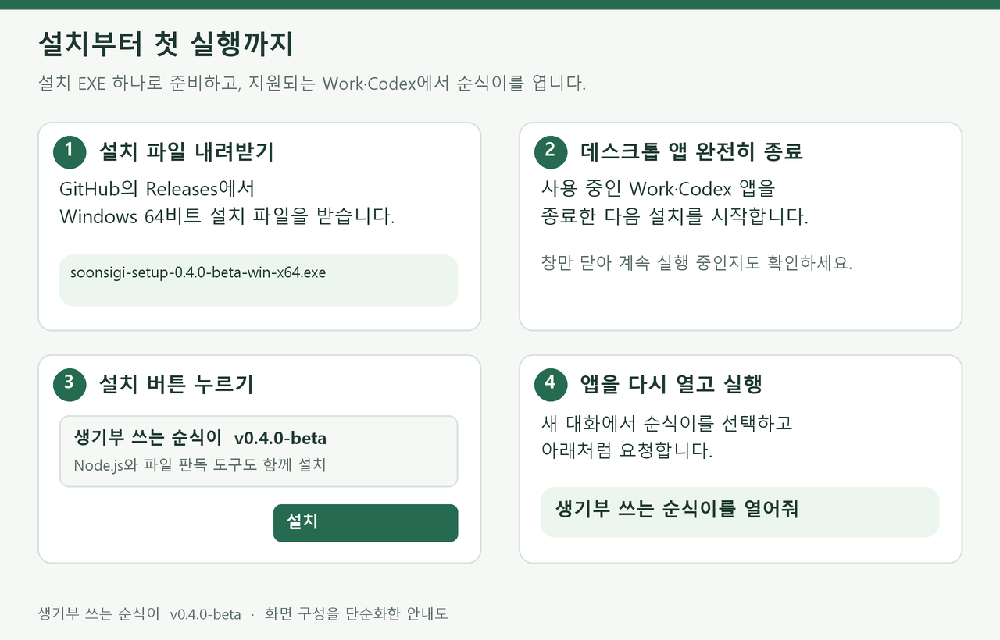
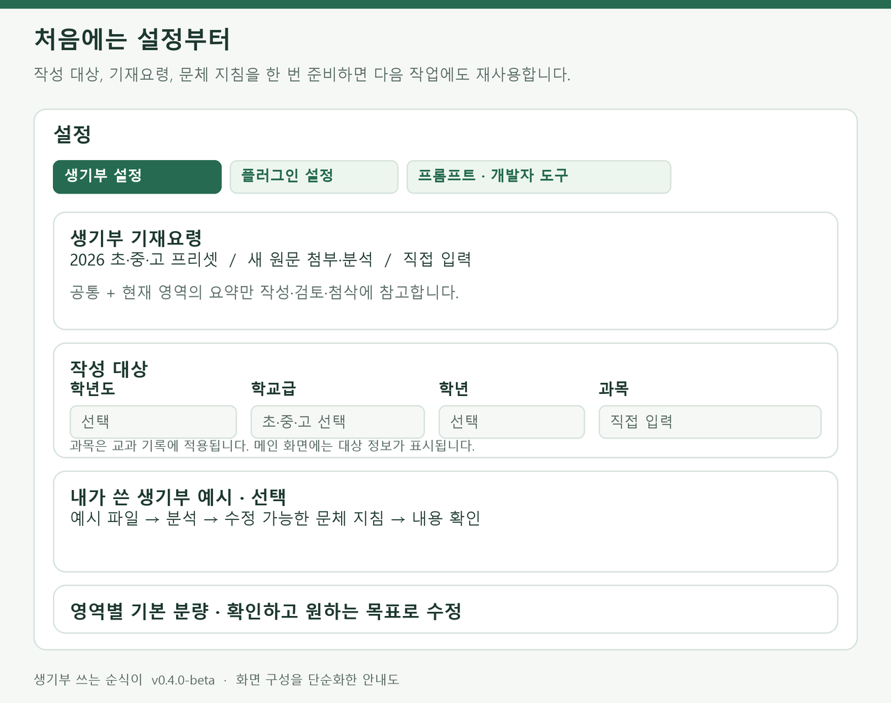
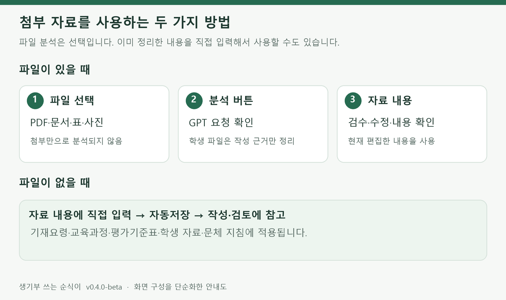
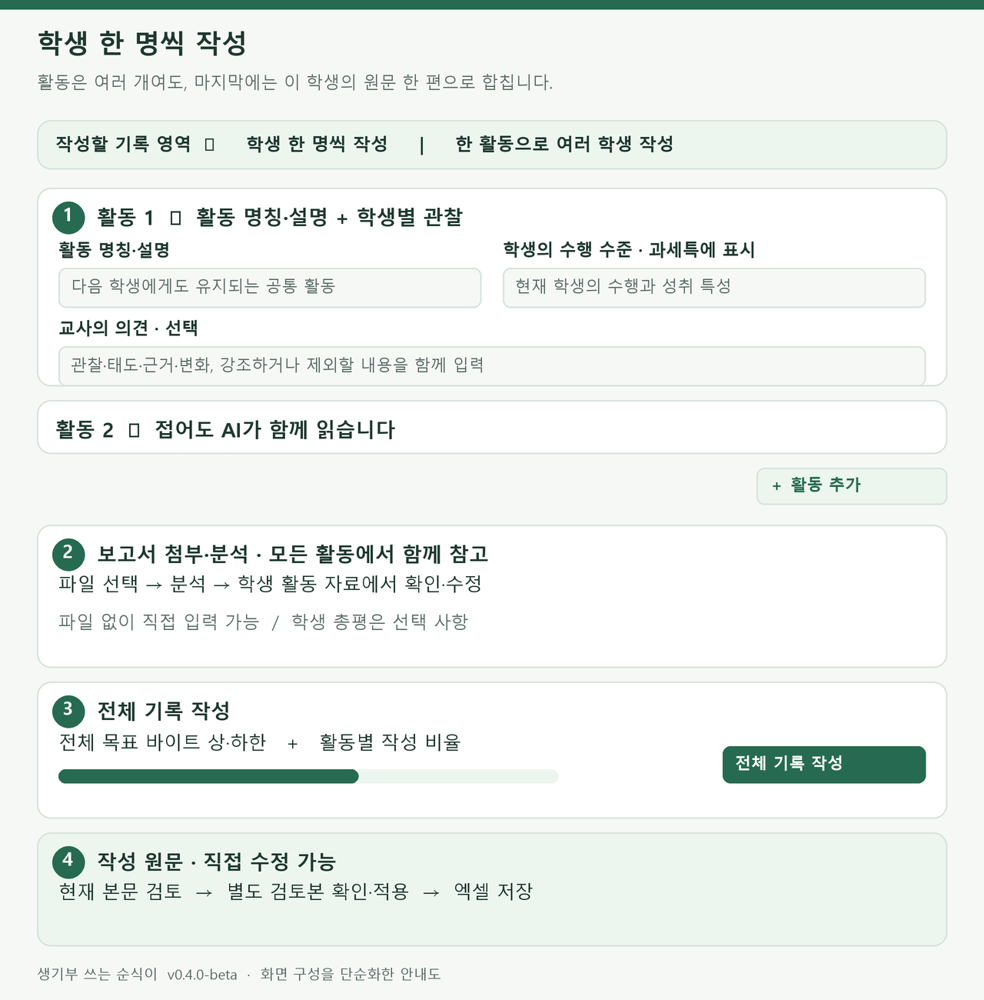
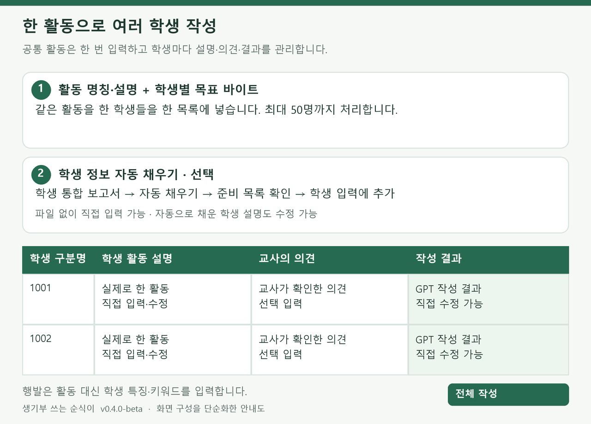
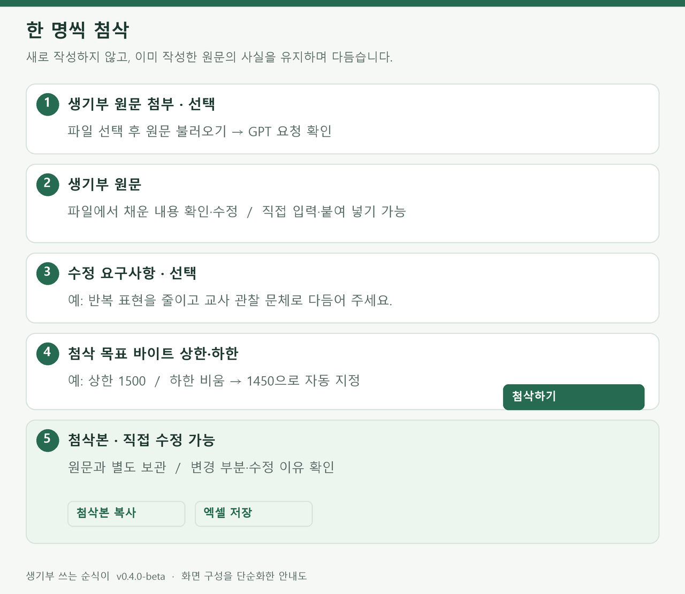
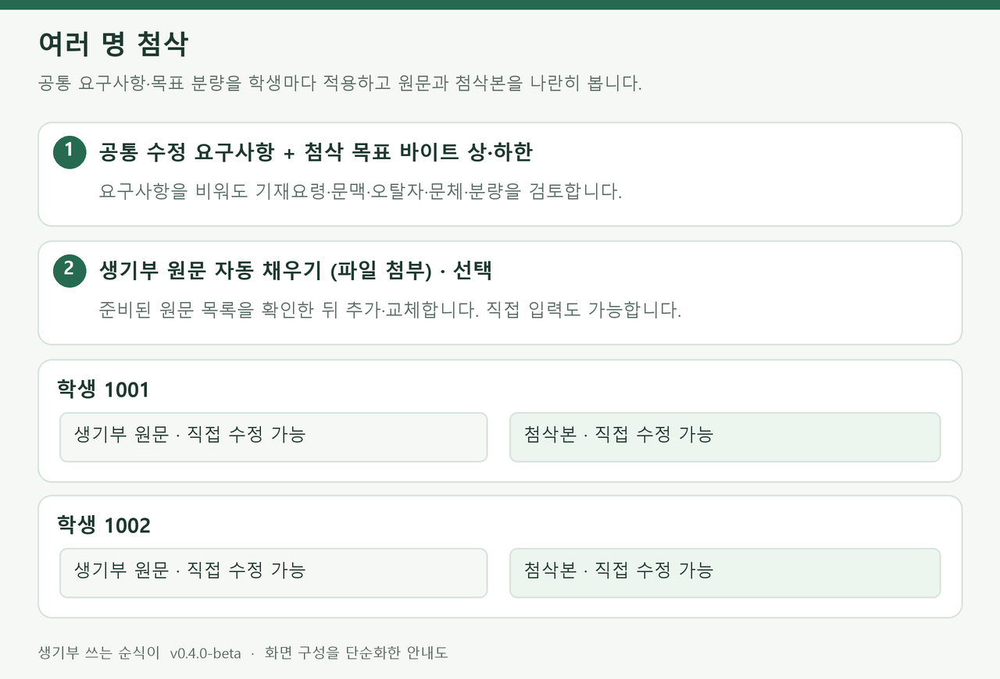
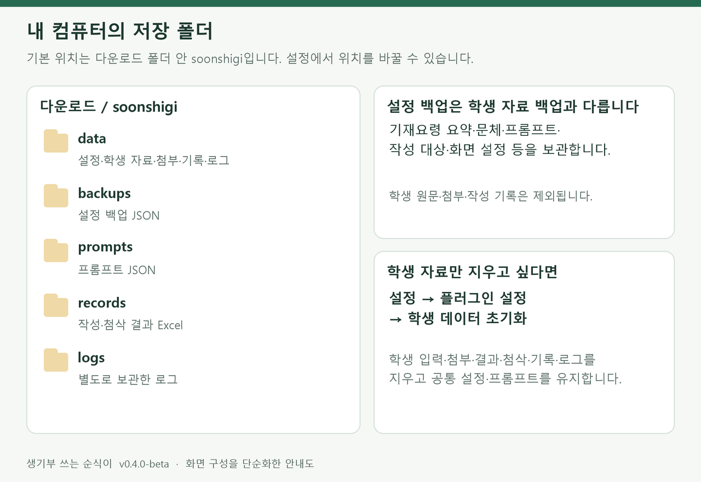
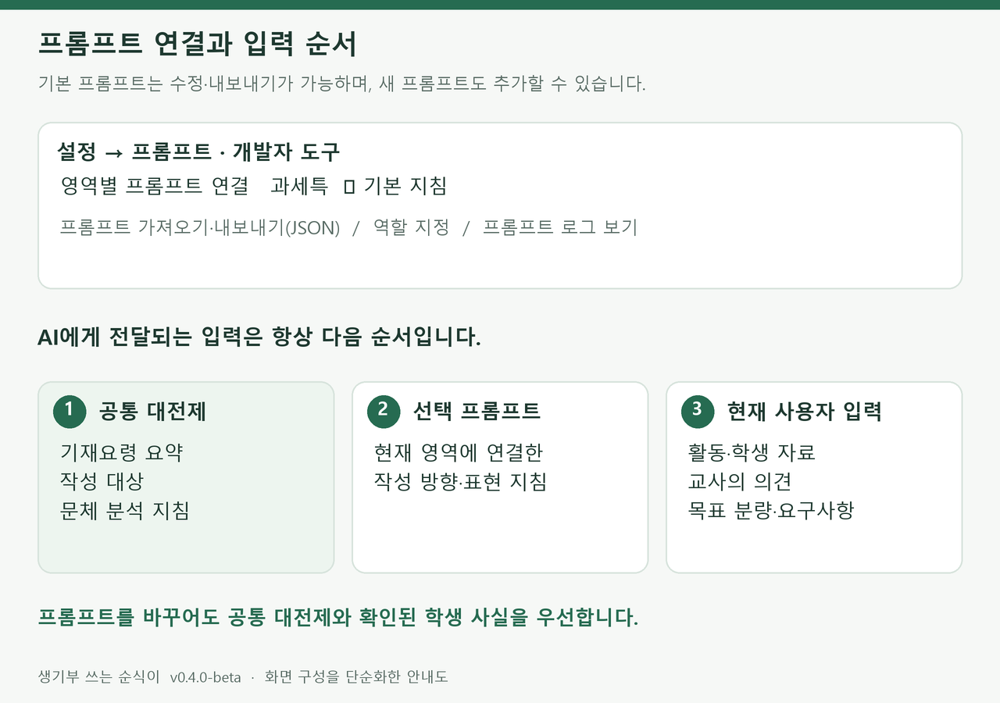

# 생기부 쓰는 순식이

**v0.4.0-beta**

교사의 자료와 관찰을 바탕으로 학교생활기록부를 작성하고, 이미 쓴 생기부를 첨삭하는 개인용 도구입니다. 자료와 입력은 내 컴퓨터에 저장하고, 분석·작성·검토·첨삭은 연결된 Work·Codex의 GPT가 처리합니다.

**Windows 64비트 설치 EXE 하나로 준비할 수 있습니다. Node.js를 따로 설치하거나 명령어를 입력할 필요가 없습니다.**

이 설명서의 그림은 현재 화면 구성을 단순화한 안내도입니다. 실제 화면의 색상과 배치는 테마·글씨 크기·창 크기에 따라 달라질 수 있습니다. 그림 속 학번과 입력값은 설명용 예시입니다.

## 필요한 내용으로 바로 이동

- [다운로드·설치·첫 실행](#install)
- [처음 설정하기](#setup)
- [학교급과 기록 영역](#areas)
- [파일 첨부와 직접 입력](#materials)
- [학생 한 명씩 작성](#write-single)
- [한 활동으로 여러 학생 작성](#write-batch)
- [이미 작성한 생기부 첨삭](#proofreading)
- [본문 검토·엑셀 저장·작성 기록](#results)
- [자동저장·설정 백업·저장 위치](#storage)
- [초기화 버튼의 차이](#reset)
- [프롬프트와 화면 설정](#prompts)
- [문제가 생겼을 때](#help)
- [이용 조건](#license)

<a id="install"></a>

## 1. 다운로드·설치·첫 실행



### 설치 전에 확인할 것

- Windows 64비트 컴퓨터를 사용합니다.
- **로컬 플러그인을 실행할 수 있는 Work 또는 Codex 환경**이 필요합니다. 순식이는 GPT와 연결해서 사용하는 프로그램입니다.
- 현재 설치본의 화면 열기는 Work·Codex를 대상으로 합니다. 일반 Chat 화면이나 웹 채팅에 EXE·ZIP을 첨부하는 방식으로 사용하지 않습니다.
- 설치 파일은 실행 환경과 파일 판독 도구를 포함합니다. 별도의 AI API 키는 필요하지 않으며, 사용하는 GPT의 계정·이용 한도는 해당 호스트를 따릅니다.

### ① 설치 파일 받기

이 GitHub 저장소의 **Releases**로 들어가 `v0.4.0-beta`의 첨부 파일을 펼칩니다. 다음 파일을 내려받으세요.

| 파일 | 용도 |
| --- | --- |
| `soonsigi-setup-0.4.0-beta-win-x64.exe` | Windows 간편 설치 파일. 일반 사용자는 이 파일을 받으면 됩니다. |
| `설치-먼저읽기.txt` | 설치 순서를 짧게 정리한 안내입니다. |
| `.sha256` 파일 | 설치 파일을 확인할 때 쓰는 체크섬입니다. 실행하는 파일이 아닙니다. |
| `soonsigi-0.4.0-beta-local.zip` | 수동으로 연결하는 사용자를 위한 로컬 플러그인 묶음입니다. EXE로 설치했다면 추가로 받을 필요가 없습니다. |

GitHub가 자동으로 제공하는 **Source code (zip)**와 순식이 설치 EXE는 서로 다른 파일입니다. 간편 설치에는 이름에 `setup`이 들어간 EXE를 선택하세요.

### ② 앱을 종료하고 설치하기

1. 사용 중인 Work·Codex 데스크톱 앱을 완전히 종료합니다.
2. 내려받은 `soonsigi-setup-0.4.0-beta-win-x64.exe`를 실행합니다.
3. 설치창에서 **설치**를 누릅니다.
4. 완료될 때까지 기다린 뒤 설치창을 닫습니다.

설치기는 순식이와 실행 환경을 준비하고 지원되는 로컬 플러그인 목록에 등록합니다. 기존에 사용하던 순식이의 설정·학생 자료·지정한 저장 위치는 유지합니다. 배포 파일에 제작자의 개인 설정이나 학생 자료를 넣어 두지 않습니다.

### ③ 순식이 화면 열기

1. 데스크톱 앱을 다시 실행합니다.
2. **Work 또는 Codex에서 새 대화**를 엽니다.
3. 플러그인 목록에서 **생기부 쓰는 순식이**를 선택합니다. 호스트에 따라 목록의 위치나 마지막 설치 확인 단계가 다를 수 있습니다.
4. 다음과 같이 요청합니다.

> 생기부 쓰는 순식이를 열어줘

이름만 보이는 상태와 도구가 연결된 상태는 다를 수 있습니다. 화면이 열리지 않으면 [문제 해결](#help)을 확인하세요.

### 이후 실행과 업데이트

매번 EXE를 실행할 필요는 없습니다. 다음부터는 Work·Codex의 새 대화에서 순식이를 선택하고 열어 달라고 요청하면 됩니다.

새 버전은 **데스크톱 앱 종료 → 새 설치 EXE 실행 → 앱 다시 실행** 순서로 적용합니다. 현재 GitHub의 최신 버전을 자동으로 찾아 설치하는 기능은 없습니다.

<a id="setup"></a>

## 2. 처음 설정하기

처음 열면 설정창이 먼저 나타납니다. 나중에는 화면 오른쪽 위의 **설정**으로 다시 열 수 있습니다. 설정은 작성과 첨삭이 공유합니다.



### ① 작성 대상부터 맞추기

**설정 → 생기부 설정 → 작성 대상**에서 다음 순서로 지정합니다.

1. **학년도**
2. **학교급**: 초등학교·중학교·고등학교
3. **학년**
4. **과목**: 직접 입력

과목은 교과 기록에만 적용됩니다. 설정창에서는 과목 칸을 계속 보여 주지만, 다른 영역의 작성 화면에는 과목을 표시하지 않습니다. 동아리활동 작성 화면의 대상 표시에서는 학년을 생략합니다.

작성 대상은 메인 화면에 표시됩니다. 다른 학년이나 과목의 기록을 시작하기 전, 이 표시를 확인하세요. 기본 자동저장이 켜져 있으면 변경한 값은 자동으로 저장됩니다.

설정을 마치면 창 아래의 **작성 화면으로**를 누릅니다. 첨삭 중에 설정을 열었다면 **첨삭 화면으로**라고 표시됩니다.

### ② 생기부 기재요령 확인하기

**2026 초등학교·중학교·고등학교 기재요령의 원본 PDF와 발췌 요약**을 기본 자료로 제공합니다. 처음에는 고등학교 자료가 들어 있으며 학교급을 설정하면 대응하는 자료와 기본 분량을 적용합니다.

- 이미 정리된 요약을 사용하면 같은 긴 PDF를 매번 분석할 필요가 없습니다.
- 요약은 **공통 / 창체 공통 / 영역별 항목**의 접히는 상자로 나뉩니다. 펼쳐서 내용을 읽고 직접 고칠 수 있습니다.
- 작성할 때는 **공통 지침과 현재 영역에 필요한 지침**을 연결합니다. 창체 공통 지침은 해당 창체 영역에서 함께 참고합니다.
- 프리셋 교체 버튼은 요약뿐 아니라 학교급·학년도·기본 분량과 현재 목표 분량도 바꿀 수 있습니다. 교체 확인창의 내용을 읽고 적용하세요.
- 새 기재요령은 파일을 첨부하고 **분석**한 뒤 요약·공식 상한을 검수하면 됩니다. 파일 없이 직접 지침을 입력해도 사용할 수 있습니다.

공식 원문은 [학교생활기록부 종합지원포털](https://star.moe.go.kr)에서 찾을 수 있습니다.

2027년처럼 기본 자료가 없는 학년도를 선택하면 2026 자료를 대신 적용할지 묻습니다. 확인하면 **이전 연도 자료를 임시로 사용하는 것**이며, 그 자료가 새 학년도 규정으로 바뀌는 것은 아닙니다. 새 원문을 구했다면 직접 첨부·분석해 교체할 수 있습니다.

### ③ 내가 쓴 생기부 예시로 문체 맞추기 · 선택

**내가 쓴 생기부 예시**에서 예시 파일을 선택하고 **분석**을 누릅니다. GPT가 문장 길이, 어미, 표현 방식, 사실과 평가를 연결하는 방식을 문체 지침으로 정리합니다.

1. 평소 쓰던 완성 기록 몇 개를 한 파일에 넣어 첨부합니다. 3~5개 정도로 시작할 수 있고 필수 개수는 없습니다.
2. **분석**을 누르고 GPT 요청을 확인합니다.
3. 아래에 표시된 분석 내용을 읽고 필요한 부분을 수정합니다.
4. 분석 결과의 **내용 확인**을 마칩니다.

다음 작성·첨삭부터 이 지침을 참고합니다. 예시 속 학생의 사실을 새 학생에게 옮기는 기능이나 GPT 모델을 영구적으로 학습시키는 기능은 아닙니다. 문체 지침을 직접 입력하는 것도 가능합니다.

### ④ 영역별 기본 분량 확인하기

생기부 설정 맨 아래의 **영역별 기본 분량**을 확인합니다. 기재요령 분석·프리셋의 공식 정보로 상한을 채우며 사용자가 원하는 목표로 조정할 수 있습니다.

초등학교처럼 프로그램이 별도 공식 숫자 상한을 적용하지 않는 영역은 목표 분량을 직접 정합니다. 다른 학교급의 숫자를 임의로 가져오지 않습니다. 최종 요청은 확인된 공식 상한이 있으면 그 범위 안에서 처리합니다.

<a id="areas"></a>

## 3. 학교급과 기록 영역

메인 화면의 **작성할 기록 영역** 또는 **첨삭할 기록 영역**에서 고릅니다. 영역을 바꾸면 설정에서 연결한 프롬프트도 자동으로 선택됩니다.

| 중·고등학교의 작성 영역 | 화면에서 주로 입력하는 내용 |
| --- | --- |
| 교과 세부능력 및 특기사항 | 활동 명칭·설명, 학생 자료, 수행 수준, 교사의 의견. 과목별 교육과정과 평가기준표는 선택 참고 자료입니다. |
| 자율·자치활동 / 자율활동 | 활동과 실제 참여·역할·변화에 대한 자료, 교사의 의견 |
| 진로활동 | 활동 자료·교사의 의견, 학생의 진로명 또는 관심 분야 |
| 동아리활동 | 동아리명·설명, 활동 자료, 교사의 의견 |
| 행동특성 및 종합의견 | 담임 교사가 확인한 학생 특징과 키워드 |
| 개인별 세부능력 및 특기사항 | 해당 영역에 맞는 활동 자료와 교사의 의견 |

2026학년도 중·고등학교 3학년을 선택하면 자율활동 명칭을 표시합니다. **초등학교는 성취수준 및 특기사항 / 자율·자치·동아리활동 통합 / 진로활동 / 행동특성 및 종합의견**의 네 영역으로 바뀝니다. 중학교 자유학기활동은 별도 작성 영역으로 지원하지 않습니다.

행발 작성은 활동 입력 탭 대신 학생 특징·키워드·작성 결과 목록을 사용합니다. 다른 영역은 **학생 한 명씩 작성**과 **한 활동으로 여러 학생 작성**을 고를 수 있습니다. 필수 정보를 아직 채우지 않아도 화면과 설정을 둘러볼 수 있으며, 실제 GPT 요청 전에 필요한 정보를 확인합니다.

<a id="materials"></a>

## 4. 파일 첨부와 직접 입력



### 파일로 넣을 때

**파일 선택 → 분석 버튼 → GPT 요청 확인 → 정리 결과 검수·수정** 순서입니다. 파일을 선택하기만 해서는 분석 요청이 시작되지 않습니다.

학생 보고서는 **분석**, 여러 학생 통합 보고서는 **학생 정보 자동 채우기**, 첨삭 원문은 **원문 불러오기** 버튼을 사용합니다. 목적에 따라 버튼명이 다릅니다.

| 자료 종류 | 분석하는 내용 |
| --- | --- |
| 생기부 기재요령 | 현재 작성 대상과 서술형 기록에 필요한 규칙·금지/허용 조건·영역별 지침·공식 분량 |
| 과목별 교육과정 | 설정한 학교급·학년·과목에 맞는 핵심 역량·성취기준·평가 방향 |
| 평가기준표·평가계획서 | 해당 과목의 **모든 수행평가와 각 평가 기준**. 먼저 전체 기준을 준비하고, 작성할 때 선택한 활동의 기준만 참고합니다. |
| 학생 활동 자료 | 학생이 실제로 한 선택·과정·방법·결과 등 생기부 작성의 근거가 되는 부분 |
| 내가 쓴 생기부 예시 | 재사용할 문체 지침. 예시 학생의 이름·성적·활동 사실을 새 기록에 옮기지 않습니다. |
| 첨삭할 생기부 원문 | 요약하지 않고 기존 원문을 그대로 추출합니다. 첨삭은 이후 별도로 요청합니다. |

GPT가 만든 참고 요약은 내용을 검수하고 **내용 확인**을 마쳐야 작성 근거로 사용할 수 있습니다. 교사가 직접 입력·수정한 요약도 저장된 현재 내용으로 사용합니다.

### 파일이 없을 때

각 자료의 **자료 내용 / 학생 활동 자료 / 문체 지침** 글상자에 직접 입력하거나 붙여 넣으세요. 파일 첨부와 분석을 필수로 거칠 필요가 없습니다.

자동저장이 켜져 있으면 입력한 글을 자동으로 저장합니다. 자동저장을 껐다면 해당 화면의 저장 버튼을 사용합니다. GPT는 사용자가 현재 글상자에서 수정한 내용을 읽으며, 지운 내용을 첨부 원문에서 되살려 쓰지 않도록 구성되어 있습니다.

### 지원 형식과 판독 범위

| 형식 | 사용할 수 있는 내용 |
| --- | --- |
| PDF | 문서 텍스트, 페이지 이미지. 스캔·손글씨는 GPT가 페이지를 읽고 판독합니다. |
| PNG, JPG/JPEG | 사진·손글씨 등 원본 이미지 |
| DOCX | 본문과 표의 텍스트 |
| XLSX | 시트·셀·저장된 값과 수식 정보. 그림·차트 해석이나 수식 재계산 기능은 아닙니다. |
| HWP(5.x), HWPX | 본문과 표의 텍스트. 보호·암호·구형 문서는 읽을 수 있는 사본으로 바꿔 주세요. |
| TXT, MD, CSV, TSV | UTF-8 텍스트 |

파일당 최대 **12MB**, PDF는 최대 **1000쪽**입니다. DOCX·HWP·HWPX 안에 들어 있는 손글씨나 그림은 필요한 부분을 PDF·이미지로 따로 첨부하세요. 예전 DOC·XLS 파일은 DOCX·XLSX 또는 PDF로 변환합니다.

판독이 불분명한 부분은 원본과 대조해 고쳐 주세요. 새로 분석한 학생 자료는 기존 정리 뒤에 추가하며, 여러 자료의 내용을 한 글상자에서 수정할 수 있습니다. 첨부만 삭제했다고 이미 편집한 요약 글까지 지워지는 것은 아니므로 필요 없는 내용은 글상자에서도 지웁니다.

<a id="write-single"></a>

## 5. 학생 한 명씩 작성

**한 학생의 여러 활동을 입력하고, 마지막에 원문 한 편으로 합치는 방식**입니다.



### ① 과세특의 공통 참고 자료 준비 · 선택

과세특 화면 위의 **과목별 교육과정**과 **평가기준표**를 펼칩니다. 파일을 분석하거나 자료 내용을 직접 넣으세요.

평가기준표는 **평가계획서 전체 분석 → 모든 수행평가와 기준 확인 → 작성할 활동 선택** 순서로 사용합니다. 현재 활동 한 개만 먼저 정리하는 방식이 아닙니다. 한 번 확인한 자료는 접어 두어도 AI가 계속 참고합니다.

다른 영역에는 이 교과 참고 자료 입력칸을 표시하지 않습니다.

### ② 활동별로 입력하기

1. 활동 박스에 **활동 명칭·설명**을 입력합니다. 다음 학생에게도 유지하는 공통 내용입니다.
2. 과세특이라면 **학생의 수행 수준**에 실제 수행과 성취 특성, 점수·수준의 의미를 적습니다.
3. **교사의 의견**에 확인한 관찰, 태도, 평가 근거, 피드백과 이후 변화를 적습니다. 강조할 내용과 제외할 내용도 같은 칸에 함께 적습니다. 선택 사항입니다.
4. **활동 추가**로 필요한 활동을 더 넣습니다.

자동저장 후 활동 명칭이 접힌 박스의 제목에 반영됩니다. 저장된 명칭·설명도 언제든 수정할 수 있습니다. 활동을 접어 두어도 작성 시에는 모든 활동을 읽습니다.

자율·자치·진로·동아리는 교과 수행 수준 칸을 사용하지 않습니다. 진로활동에는 진로 분야를, 동아리활동에는 동아리명·설명을 추가로 입력할 수 있습니다. 개세특은 과세특과 구분된 입력·지침을 사용합니다.

### ③ 학생 보고서와 총평 넣기 · 선택

활동 박스 아래의 **보고서 첨부·분석**을 펼칩니다.

- **＋ 버튼**으로 보고서를 여러 개 선택할 수 있습니다. 분석 결과는 공통 **학생 활동 자료**에 모입니다.
- 활동마다 같은 보고서를 반복 첨부할 필요가 없습니다. GPT가 활동 명칭과 내용을 보고 해당 근거를 대응합니다.
- 파일 없이 글상자에 직접 입력해도 됩니다. 분석 후에도 자유롭게 수정할 수 있습니다.
- **학생 총평**에는 활동 전체를 아우르는 학생의 수행과 교사의 의견을 적습니다. 선택 사항입니다.

### ④ 전체 분량과 활동 비율 정하기

**전체 기록 작성**에서 상한·하한을 정합니다. 이 값은 **모든 활동을 합친 원문 한 편**의 목표입니다.

예를 들어 상한이 1500바이트라면 활동 3개를 각각 1500바이트씩 쓰는 것이 아니라, 세 활동을 합쳐 1500바이트 안에서 씁니다.

- 하한을 비우면 **상한−50바이트**를 자동 목표로 사용합니다. 상한 1500이면 하한 1450입니다.
- 하한에 **0**을 입력하면 최소 분량 제한을 두지 않습니다.
- **활동별 작성 비율** 막대의 경계점을 마우스로 드래그해 활동별 비중을 정합니다. 비율은 전체 목표 안에서 분량을 배분하는 기준입니다.

### ⑤ 작성하고 다음 학생으로 이동하기

1. **전체 기록 작성** 버튼을 누릅니다. 영역에 따라 버튼의 기록 명칭이 달라집니다.
2. GPT 요청 확인창에서 **확인**을 누릅니다.
3. 결과가 나오면 마지막 **작성 원문**에서 내용을 읽고 직접 수정합니다.
4. 필요한 경우 **검토**하고 **엑셀 저장**합니다.
5. 완료했으면 **다음 학생**을 누르고 확인합니다.

다음 학생은 명칭·설명·공통 참고 자료·분량 설정을 유지하고 현재 학생의 자료·수행 수준·의견·원문을 비웁니다. **전체 초기화**와는 지우는 범위가 다릅니다. [초기화 비교표](#reset)를 확인하세요.

<a id="write-batch"></a>

## 6. 한 활동으로 여러 학생 작성

같은 활동을 한 학생들의 기록을 한꺼번에 작성하는 방식입니다. 한 학생의 여러 활동을 합치는 앞의 방식과 구분해서 사용하세요.



### 직접 입력해서 작성하기

1. **한 활동으로 여러 학생 작성**을 선택합니다.
2. 공통 **활동 명칭·설명**과 **학생별 목표 바이트 상·하한**을 입력합니다.
3. **학생 추가 / 5명 추가**로 입력할 학생을 늘립니다. 한 번에 최대 **50명**까지 넣을 수 있습니다.
4. 학생별 **구분명**에 이름·학번·번호·별칭을 입력합니다.
5. **학생 활동 설명**과 **교사의 의견**을 적습니다. 강조·제외 요청도 교사의 의견에 함께 적을 수 있습니다.
6. **전체 ○명 작성** 또는 학생별 **작성**을 누릅니다.
7. 각 결과를 검토·수정하고 **전체 엑셀 저장**합니다.

목표 분량은 학생마다 각각 적용합니다. 여러 학생의 바이트 합계를 한 상한으로 계산하지 않습니다. 학생별 설명과 의견을 모두 비우면 공통 활동을 바탕으로 일반적인 표현의 초안을 작성하도록 안내하지만, 그 초안을 개별 학생의 관찰 사실로 단정하지 말고 실제 수행과 맞는지 확인하세요.

### 통합 보고서로 학생 정보 자동 채우기

1. 먼저 작성할 **활동 명칭·설명**을 입력합니다.
2. **학생 통합 보고서**에서 파일을 선택합니다.
3. **학생 정보 자동 채우기**를 누르고 GPT 요청을 확인합니다.
4. **준비된 학생 ○명 보기**를 펼쳐 구분명·활동 설명을 확인합니다.
5. **학생 입력에 추가** 또는 **기존 목록 대신 채우기**를 선택합니다.
6. 채워진 내용을 직접 수정하고 교사의 의견을 덧붙인 뒤 작성합니다.

이름이 없으면 학번을 구분명으로 사용합니다. 학생과 활동을 구분할 수 있는 문서·표·사진을 사용할 수 있고, 정해진 엑셀 양식이나 셀 병합 형식만을 요구하지 않습니다. 학생·활동 연결이 불명확하면 추측해서 채우지 않습니다.

**기존 목록 대신 채우기**는 기존 목록의 교사 의견과 수정 결과도 교체할 수 있으므로 확인창을 읽고 선택하세요. 기존 입력을 유지하려면 추가를 사용합니다.

### 행발은 어떻게 쓰나요?

행발 작성은 활동 명칭·보고서 대신 **학생 특징 / 키워드**를 입력합니다. 담임 교사가 확인한 생활 모습과 관계·태도·변화를 바탕으로 쓰며, 다른 영역의 활동 설명이나 성적을 요구하지 않습니다.

<a id="proofreading"></a>

## 7. 이미 작성한 생기부 첨삭

상단의 **생기부 첨삭**으로 이동하고 **첨삭할 기록 영역**을 선택합니다. 작성 화면의 공통 설정·기재요령·문체·연결 프롬프트를 함께 사용합니다.

수정 요구사항이 없어도 **기재요령, 문맥·논리, 오탈자·띄어쓰기, 교사 문체, 바이트 수**를 검토합니다. 요구사항이 있으면 이 기본 검토에 추가로 반영합니다. 원문에 없는 활동·관찰·성취를 만들거나 분량을 채우기 위해 사실을 덧붙이는 용도로 사용하지 않습니다.

### 한 명씩 첨삭



1. 원문 파일이 있으면 선택하고 **원문 불러오기**를 누릅니다. GPT 요청을 확인하고 기다리면 **생기부 원문** 칸을 자동으로 채웁니다.
2. 파일이 없으면 **생기부 원문**에 직접 입력하거나 붙여 넣습니다. 파일에서 채운 원문도 수정할 수 있습니다.
3. **수정 요구사항**을 적습니다. 선택 사항입니다.
4. **첨삭 목표 바이트 상한·하한**을 정합니다. 하한을 비우면 상한−50바이트, 0이면 하한 제한 없음입니다.
5. **첨삭하기**를 누르고 GPT 요청을 확인합니다.
6. 아래 **첨삭본**에서 결과를 확인하고 직접 수정합니다. 변경 비교와 수정 이유도 펼쳐 볼 수 있습니다.
7. **첨삭본 복사 / 엑셀 저장**으로 가져갑니다.

원문과 첨삭본은 별도로 유지됩니다. 이미 원문·첨삭본을 입력한 상태에서 새 파일을 불러오면 교체 전에 확인하며, 정상적으로 불러온 뒤 이전 첨삭본을 비웁니다. 한 명 첨삭에는 한 학생의 원문만 넣으세요.

수정 요구사항 예시:

> 반복되는 종결 표현을 줄이고, 학생이 한 선택과 행동이 자연스럽게 이어지도록 다듬어 주세요. 새로운 사실은 추가하지 마세요.

### 여러 명 첨삭



1. **여러 명 첨삭**을 선택합니다.
2. **공통 수정 요구사항**과 목표 바이트 상·하한을 입력합니다.
3. 원문을 직접 붙여 넣거나 **생기부 원문 자동 채우기 (파일 첨부)**를 펼쳐 파일을 불러옵니다.
4. 파일에서 준비된 학생 구분·원문을 확인하고 **학생 목록에 추가** 또는 **현재 목록 바꾸기**로 반영합니다.
5. 학생별 원문을 필요에 맞게 수정합니다. **학생 추가**로 직접 입력할 학생을 늘릴 수 있습니다.
6. **전체 첨삭** 또는 **이 학생 첨삭**을 누릅니다.
7. 나란히 표시되는 원문·첨삭본을 확인하고 **전체 엑셀 저장**합니다.

최대 50명까지 처리하며 공통 요구와 목표 분량을 각 학생에게 적용합니다. 학생별 경계나 원문 대응이 불명확하면 목록에 적용하지 않습니다. 엑셀에는 학생 구분명과 원문/작성 결과를 구분할 수 있는 열 제목을 두면 확인하기 쉽습니다. 파일 없이 직접 입력하는 방식도 계속 사용할 수 있습니다.

원문·요구사항·분량·설정이 바뀌면 이전 첨삭본에 다시 첨삭이 필요하다고 표시할 수 있습니다. 현재 입력을 기준으로 다시 요청하세요.

<a id="results"></a>

## 8. 본문 검토·엑셀 저장·작성 기록

### 작성 후 검토와 첨삭의 차이

| 기능 | 사용할 때 | 결과 표시 |
| --- | --- | --- |
| 작성 화면의 **검토** | 지금 작성 원문 칸에 있는 본문을 점검할 때 | 원문 아래에 별도 검토본과 수정 제안을 표시합니다. |
| **생기부 첨삭** 페이지 | 이미 쓴 원문을 불러와 수정 요구와 목표 분량을 지정할 때 | 원문과 첨삭본을 별도로 보관하고 첨삭본을 편집합니다. |

작성 화면에서 **검토**는 현재 글상자의 최신 내용을 대상으로 합니다. 원문을 자동으로 덮어쓰지 않으며, 제안을 확인한 후 **검토본을 원문에 적용**을 눌러야 반영합니다.

추가·수정 부분은 초록색 밑줄, 삭제 부분은 비교 화면의 빨간색 취소선으로 구분합니다. 검토 이후 본문을 다시 고쳤다면 최신 본문으로 재검토하세요.

### 결과를 Excel로 저장하기

**엑셀 저장** 또는 **전체 엑셀 저장**을 누르면 저장 위치를 고르는 창을 엽니다. 기본 위치는 저장 폴더 안의 `records`입니다.

| 학생 구분명 | 작성 결과 | 바이트 수 |
| --- | --- | --- |
| 1001 | 현재 화면에서 확인·수정한 본문 | 저장 시점에 계산한 값 |
| 1002 | 다음 학생의 현재 본문 | 저장 시점에 계산한 값 |

한 명 작성·첨삭처럼 구분명 입력칸이 없는 경우에는 **현재 학생**으로 표시합니다. 한 학생 파일을 여럿 모아 관리한다면 저장할 때 파일명도 알아보기 쉽게 바꾸세요. 엑셀 저장은 한 명 작성·여러 학생 작성·첨삭에서 모두 사용할 수 있습니다.

분량은 한글 1자 3바이트, 영문·숫자·공백 1바이트, 줄바꿈 1바이트로 계산합니다. 수정한 현재 본문을 기준으로 계산하므로, 편집 후 화면의 바이트 수를 다시 확인하세요.

### 작성 기록 보기

상단 **설정** 왼쪽의 **작성 기록**을 누릅니다. 목록의 항목을 펼치면 작성 원문·검토본 또는 첨삭 전 원문·첨삭본, 수정 제안과 바이트를 확인할 수 있습니다.

작성 기록은 결과 저장 시점의 기록이며, 입력 중인 자동저장본과는 구분됩니다. 기록창은 열람용입니다. 필요한 글을 복사해 현재 작성·첨삭 화면에 붙여 넣어 사용할 수 있습니다.

<a id="storage"></a>

## 9. 자동저장·설정 백업·저장 위치



### 어디에 저장되나요?

기본 위치는 **이 컴퓨터의 다운로드 폴더 안 `soonshigi`**입니다. 설정에서 표시되는 실제 경로를 확인하세요. 배포 파일 이름의 `soonsigi`와 저장 폴더 이름 `soonshigi`는 철자가 다릅니다.

```text
다운로드/
└─ soonshigi/
   ├─ data/       설정·학생 입력·첨부·요약·기록·로그·자동저장본
   ├─ backups/    설정 백업 JSON
   ├─ prompts/    내보낸 프롬프트 JSON
   ├─ records/    작성·첨삭 결과 Excel
   └─ logs/       별도로 보관하는 로그
```

학생 자료와 설정은 내 컴퓨터에 저장됩니다. 다만 **분석·작성·검토·첨삭을 요청하면 필요한 입력은 연결된 GPT로 전달**됩니다. 로컬 저장과 GPT에 자료를 보내지 않는 것은 같은 뜻이 아닙니다.

### 자동저장과 복구

기본값은 **자동저장 켜짐**입니다. 입력을 잠시 멈추면 입력·편집한 본문·요약·프롬프트를 자동으로 저장합니다. 완료하면 오른쪽 위에 작은 디스켓 표시가 약 1초 나타났다가 사라집니다.

**설정 → 플러그인 설정 → 자동저장·복구**에서 켜거나 끌 수 있습니다. 다시 열 때 저장된 작업을 불러오며, 입력 중 임시본이 남아 있다면 복구합니다. 파일을 선택만 한 상태는 첨부·저장되지 않으며 분석 또는 불러오기를 눌러야 합니다.

### 저장 폴더 바꾸기·바로 열기

1. **설정 → 플러그인 설정 → 저장 폴더**로 갑니다.
2. 경로 옆의 **작은 폴더 아이콘**을 누르면 해당 폴더를 엽니다.
3. **저장 폴더 변경**을 누르고 이동 확인을 합니다.
4. 새 위치를 고르면 그 안에 `soonshigi` 폴더를 만들고 기존 자료를 함께 옮깁니다.

이미 자료가 들어 있는 다른 폴더와 자동으로 섞지 않습니다. 직접 지정한 저장 위치는 새 버전을 설치해도 유지합니다. 이 기능은 Windows 로컬 플러그인에서 사용합니다.

### 설정 백업과 불러오기

**설정 백업 다운로드**를 누르면 저장할 위치를 선택하고 `.json` 파일을 만듭니다. 기본 위치는 `backups`입니다.

설정 백업에는 작성 대상, 기재요령 요약, 문체 지침, 프롬프트·연결, 화면 설정, 기본 분량 등을 담습니다. **학생 입력·첨부 원본·작성 결과·작성 기록·로그를 보관하는 전체 데이터 백업은 아닙니다.** 직접 쓴 지침에 개인정보를 넣었다면 그 글 자체는 백업에 들어갈 수 있습니다.

불러올 때는 **설정 백업 파일 선택 → 내용 확인 → 선택한 설정 불러오기** 순서입니다. 현재 설정·프롬프트를 교체하고 학생 자료는 유지합니다. 첨부 원본은 복원되지 않으며, 공통 요약은 적용 대상을 확인한 뒤 다시 확인·저장하세요.

설정과 학생 파일까지 모두 별도로 보관하려면 프로그램을 종료한 뒤 현재 `soonshigi` 폴더 전체를 복사해 둡니다. 프로그램 설치 파일·ChatGPT 대화·다른 위치에 따로 저장한 파일은 이 폴더와 별개입니다.

<a id="reset"></a>

## 10. 초기화 버튼의 차이

| 버튼·위치 | 지우는 것 | 유지하는 것 |
| --- | --- | --- |
| **다음 학생** · 한 명 작성 | 현재 학생의 입력·첨부·수행 수준·의견·작성 원문 | 활동 명칭·설명, 공통 참고 자료, 분량 설정, 작성 기록 |
| **전체 초기화** · 한 명 작성 | 활동 명칭·설명, 평가기준표, 학생 입력·첨부·작성 결과 | 과목별 교육과정, 공통 설정·프롬프트·작성 기록 |
| **학생 입력·결과 지우기** · 여러 학생 작성 | 학생 목록·통합 보고서·학생 입력·작성 결과 | 공통 활동, 설정·프롬프트·공통 참고 자료·작성 기록 |
| **활동 포함 전체 초기화** · 여러 학생 작성 | 위 학생 데이터와 공통 활동 정보 | 설정·프롬프트·공통 참고 자료·작성 기록 |
| **첨삭 입력 초기화** · 첨삭 페이지 | 한 명·여러 명 첨삭의 원문·요구사항·결과·첨부와 분량 입력 | 작성 페이지, 공통 설정·프롬프트·작성 기록 |
| **설정 값 초기화** · 플러그인 설정 | 화면 설정·자동저장·개발자 도구·영역별 기본 분량을 초기값으로 변경 | 기재요령·작성 대상·문체 지침·프롬프트·학생 자료 |
| **학생 데이터 초기화** · 플러그인 설정 | 모든 학생 입력·첨부·요약·작성/검토/첨삭 결과·작성 기록·프롬프트 로그·임시 저장본 | 설정·프롬프트·기재요령·문체 지침·교육과정·평가기준표·공통 활동 |

초기화는 확인창에서 승인한 뒤 실행합니다. **학생 데이터 초기화는 작성 기록도 지웁니다.** ChatGPT 대화와 따로 내려받은 엑셀·백업 파일까지 삭제하는 기능은 아닙니다.

현재 `soonshigi` 폴더 자체를 삭제하면 그 안의 설정·학생 자료·백업·프롬프트 파일·결과 파일을 함께 지웁니다. 학생 자료만 정리하려면 폴더 삭제 대신 **학생 데이터 초기화**를 사용하세요.

<a id="prompts"></a>

## 11. 프롬프트와 화면 설정

### 기본 프롬프트 연결



**설정 → 프롬프트 · 개발자 도구 → 영역별 프롬프트 연결**에서 각 영역에 사용할 프롬프트를 선택합니다. 저장된 프롬프트 목록에서 고를 수 있으며, 메인 화면에서 영역을 바꾸면 연결한 프롬프트를 자동으로 선택합니다.

기본 프롬프트는 영역별 6개와 초등학교 통합용 1개, 총 **7개**입니다. 기본 프롬프트는 삭제할 수 없지만 수정·내보내기는 가능합니다. **새 프롬프트**를 추가해서 자신만의 지침을 저장하고 연결할 수도 있습니다.

AI에게 전달하는 입력은 항상 다음 순서입니다.

1. **공통 대전제**: 기재요령 요약 → 작성 대상 → 문체 분석 지침
2. **선택한 프롬프트**: 현재 영역에 연결한 지침
3. **현재 사용자 입력**: 활동·학생 자료·교사의 의견·목표 분량, 첨삭 원문·수정 요구사항 등

다른 프롬프트를 선택해도 공통 대전제를 입력 맨 앞에 붙이는 구조는 유지합니다.

### 역할 지정·가져오기·내보내기

- **프롬프트 역할 지정**을 체크하면 지침을 여러 칸으로 나눠 역할과 적용 시점을 지정할 수 있습니다.
- 체크를 해제하면 한 칸으로 보이지만 지정한 역할은 유지·적용됩니다.
- **프롬프트 내보내기 (JSON)**는 현재 선택·편집 중인 프롬프트 하나를 저장합니다. 기본 위치는 `prompts`입니다.
- **프롬프트 가져오기 (JSON)**로 다른 지침을 추가할 수 있습니다. 가져온 뒤 사용할 영역에 연결하세요.

### 프롬프트 로그와 생성 가이드

**프롬프트 로그 보기**를 켜면 결과 영역에 같은 이름의 버튼을 표시하고, 이후 요청부터 로그를 기록합니다. 전달한 입력·지침, 저장된 결과, 반환된 검토 근거 요약을 보며 프롬프트를 조정할 수 있습니다. **모델의 내부 추론 원문이나 비공개 시스템 지침을 보여 주는 기능은 아닙니다.** 로그에는 학생 입력이 포함될 수 있습니다.

**프롬프트 생성 가이드 보기**를 체크하면 복사할 수 있는 가이드를 펼칩니다. 다른 GPT와 프롬프트를 만들 때 가이드를 먼저 붙여 넣고, 원하는 영역·문체·작성 방향과 함께 JSON으로 만들어 달라고 요청하세요. 완성한 JSON은 프롬프트 가져오기로 넣습니다.

### 화면 모양 바꾸기

**설정 → 플러그인 설정 → 화면 설정**에서 가로·세로모드, 라이트·다크모드와 색상 프리셋, 글씨체, 글씨 크기를 바꿀 수 있습니다. 모노톤 테마도 제공합니다.

시스템 글꼴 외에 Noto Sans KR, Noto Serif KR, 전남교육바른체 등을 고를 수 있습니다. 글씨 크기는 12~24px이며, 좁은 창에서는 입력과 버튼이 줄바꿈됩니다. 모델 선택·추론 단계는 순식이 화면의 드롭다운으로 설정하지 않습니다.

<a id="help"></a>

## 12. 문제가 생겼을 때

| 상황 | 확인할 것과 해결 방법 |
| --- | --- |
| 설치했는데 목록에 보이지 않음 | 데스크톱 앱을 완전히 종료했다가 다시 열고 Work·Codex의 새 대화에서 확인합니다. 설치 완료 여부와 호스트의 로컬 플러그인 지원도 확인하세요. |
| “직접 실행할 수 없다”는 답변만 나옴 | 일반 Chat인지 확인합니다. Work·Codex의 새 대화에서 순식이를 선택하고 열어 달라고 요청하세요. 이름이 보이는 것만으로 도구가 연결됐다고 판단하지 않습니다. |
| 파일을 선택했는데 글상자가 비어 있음 | 파일 선택 뒤 **분석 / 원문 불러오기 / 학생 정보 자동 채우기** 중 해당 버튼을 눌렀는지, GPT 요청 확인창에서 승인했는지 확인합니다. |
| 여러 학생 파일을 읽었는데 입력 목록이 그대로임 | 준비된 목록을 펼쳐 보고 **학생 입력에 추가 / 학생 목록에 추가** 같은 적용 버튼을 누릅니다. 학생·활동 구분이 불명확하면 자동 적용하지 않습니다. |
| 작성 버튼을 눌렀는데 진행되지 않음 | 경고창의 이유·해결 방법을 읽습니다. 문제가 있는 칸으로 이동해 붉게 표시될 수 있습니다. 작성 대상, 연결 프롬프트, 확인한 기재요령, 목표 바이트를 점검하세요. |
| 계속 “ChatGPT 결과를 기다립니다”로 표시됨 | 연결된 대화에서 해당 GPT 요청이 처리 중인지 확인합니다. 중단하려면 **요청 취소**를 누르고 입력과 연결 상태를 확인한 뒤 다시 요청하세요. |
| 자동 채우기 결과가 틀림 | 원본에서 학번·이름·학생 경계와 활동 명칭을 확인할 수 있는지 봅니다. 준비 목록과 채워진 내용을 직접 수정하거나 수동 입력하세요. |
| 손글씨·한글 문서가 제대로 읽히지 않음 | 선명한 PDF·PNG/JPG로 필요한 부분을 따로 첨부합니다. 보호·암호 문서는 읽을 수 있는 사본으로 바꾸고 불분명한 글자는 교사가 고칩니다. |
| 목표 분량을 맞추지 못함 | 하한이 상한보다 큰지, 공식 상한이 더 작은지 확인합니다. 하한을 채울 실제 근거가 부족하면 자료·관찰을 보완하거나 목표를 낮춥니다. |
| 저장 위치를 모르겠음 | 플러그인 설정의 실제 경로와 폴더 아이콘, 저장 후 표시된 경로를 확인합니다. 기본 결과 위치는 `다운로드/soonshigi/records`입니다. |
| 화면 미리보기에서 GPT·폴더 선택이 안 됨 | HTML 화면 미리보기는 실제 설치된 로컬 플러그인과 다릅니다. 미리보기는 임시 입력이며 창을 닫으면 사라질 수 있습니다. 실사용은 설치본을 Work·Codex에 연결해서 합니다. |

결과는 교사가 실제 학생 수행과 맞는지 확인한 뒤 사용하세요. 자동 검사와 설치 검증은 프로그램의 저장·계산·연결 동작을 확인한 것이며, 각 문서의 판독 정확도나 실제 GPT의 최종 작성 품질까지 대신 확인한 것은 아닙니다.

<a id="license"></a>

## 13. 이용 조건

개인 수정과 **무료 배포**를 허용합니다. 프로그램 원본·수정본의 **유료 판매·배포는 허용하지 않습니다.** 재배포할 때 저작권 표시와 이용 조건을 함께 유지하세요. 외부 라이브러리·글꼴·기재요령 원문의 고유 이용 조건은 각각 적용됩니다.

자세한 내용은 [LICENSE.md](LICENSE.md), 버전별 변경은 [CHANGELOG.md](docs/CHANGELOG.md)를 확인하세요.

© 2026 생기부 쓰는 순식이
